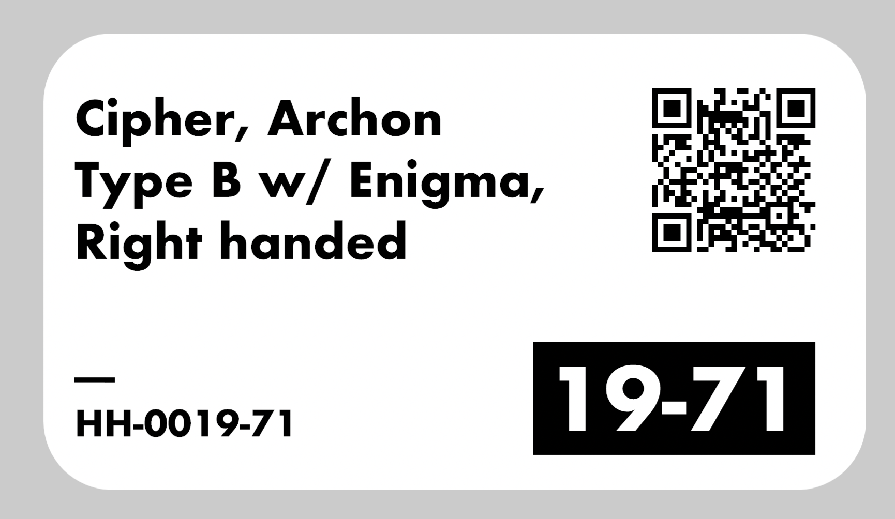

# Fulcrum Item Labels (Chrome extension)

On any Fulcrum item page (`https://henryholsters.fulcrumpro.com/ui/items/<id>`),
**Ctrl+P** (Windows) or **⌘P** (Mac) prints a 2.25" × 1.25" product label on the DYMO LabelWriter instead of
opening Chrome's print dialog. Other Fulcrum pages keep the normal shortcut.
To print the item page itself, use Chrome's ⋮ menu → Print.

**Ctrl+Shift+P** (**⌘⇧P** on a Mac) opens an editable preview first. You can
change the Description, the Item number and the black-box text, watch the label
update, then press **Enter** or **Print** (Esc cancels). The box text follows the
item number until you edit it yourself; clear it to print the label with no
black box. Shift+Enter adds a line break in the
description. Edits only change the label, never the Fulcrum item.

| Label area | Source |
|---|---|
| Main text | the item's **Description** field (shrinks to fit, up to ~5 lines) |
| Lower left | the **Item** number, e.g. `HH-0019-71` |
| Black box, lower right | the last 5 characters of the item number (`HH-0019-71` → `19-71`). A number cut in half keeps its significant digits (`X_PHL-0120-08` → `120-08`), and a leading `-` or `_` is dropped (`MFR-2985` → `2985`) |
| QR code | `ITEM-` + the item id from the URL (`ITEM-6a833274cc252675a0041033`) |

The label shows what's in the Description and Item fields when you press
the shortcut, including edits you haven't saved yet.

## How it prints without dialogs

The extension sends the label straight to the **DYMO Connect web service**
(`https://127.0.0.1:41951`), which is installed and started with **DYMO Connect
for Desktop** on Windows and **DYMO Connect for Mac** on macOS (it runs as
`DYMO.WebApi.Mac.Host`). You don't pick a printer and no print dialog opens. A small
"Label for HH-… sent to …" message appears in the corner of the page.

If the web service isn't running, the extension falls back to Chrome's print
dialog, sized to the label. You can turn that fallback off in the extension
options. To skip the dialog in that case too, set the DYMO as the system
default printer and start Chrome with `--kiosk-printing`. (On a Mac, use
`open -a "Google Chrome" --args --kiosk-printing`.)

## Install (Windows or Mac)

1. Install **DYMO Connect for Desktop** (Windows) or **DYMO Connect for Mac**, and check that it can see the
   LabelWriter loaded with **30334** (2¼" × 1¼") labels.
2. Copy this `fulcrum-labels` folder to the computer, or use this repo checkout.
3. In Chrome, go to `chrome://extensions`, turn on **Developer mode**, click
   **Load unpacked**, and select the folder.
4. Open the extension's **Details → Extension options**:
   - Check that it reports the printer. Leave **Automatic** selected, or pick a
     specific printer if the computer has more than one.
   - On a **LabelWriter Twin Turbo**, set **Twin Turbo roll** to the side
     loaded with 30334 labels.
   - Click **Print test label**.
   - If the label prints sideways or upside down, change **Rotate** and test
     again.

## Files

- `manifest.json`: Manifest V3. Runs on `henryholsters.fulcrumpro.com`; may only connect to `127.0.0.1`/`localhost` (the DYMO service).
- `content.js`: handles Ctrl+P / ⌘P, reads the Item and Description fields, shows the status message, and does the Chrome-print fallback.
- `label.js`: draws the label at 300 dpi (675 × 375 px). The content script and options page share it.
- `background.js`: finds the DYMO Connect service, lists printers, and sends the label (as a PNG inside DYMO label XML).
- `options.html` / `options.js`: printer choice, preview, test print, rotation, and an override for the label template.
- `lib/qrcode.js`: [qrcode-generator](https://github.com/kazuhikoarase/qrcode-generator) 1.4.4 (MIT).
- `fonts/Jost-700-Bold.otf`: [Jost](https://github.com/indestructible-type/Jost), a free Futura-style font (SIL OFL, see `fonts/OFL.txt`).
